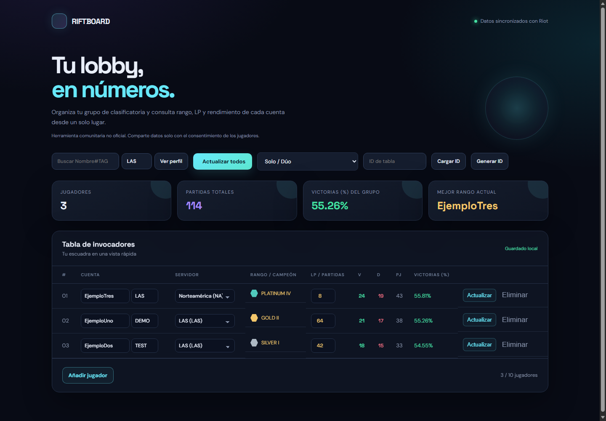
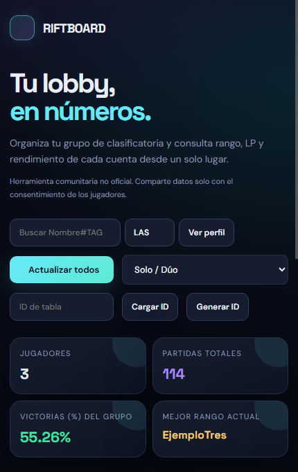

# Riftboard | League Tracker

Tracker comunitario de **League of Legends** para consultar rangos, estadísticas clasificatorias y perfiles, y compartir tablas con tu grupo. Los datos se consultan desde la Riot API.

> Herramienta comunitaria no oficial. No está afiliada, patrocinada ni aprobada por Riot Games.

## Capturas de pantalla

Las imágenes muestran datos de ejemplo; no corresponden a cuentas reales.





## Funciones

- Consulta rangos, LP y victorias/derrotas en las colas Solo/Dúo y Flex.
- Revisa perfiles con maestría de campeón, partidas recientes y jugadores recurrentes.
- Organiza hasta 10 cuentas y comparte tablas con un ID.
- Guarda los datos localmente; Supabase es opcional para persistir partidas y tablas compartidas.

## Uso local

1. Copia `.env.example` como `.env`.
2. Configura `RIOT_API_KEY` en `.env`.
3. Instala las dependencias e inicia el servidor:

```bash
npm install
npm run dev:local
```

Abre <http://localhost:3000>.

## Despliegue público

Un proyecto accesible a la comunidad no debe utilizar una Development o Interim API Key. Antes de publicarlo, solicita y configura una Production API Key aprobada específicamente para este proyecto.

En el proveedor de hosting configura estas variables, sin subir `.env` al repositorio:

```text
RIOT_API_KEY=tu_production_key
RIOT_KEY_TYPE=production
PUBLIC_DEPLOYMENT=true
```

El servidor rechazará las consultas públicas si `RIOT_KEY_TYPE` no es `production`. Cada proyecto debe tener su propia aplicación y una API key aprobada por Riot.

## Privacidad y uso responsable

- Comparte una tabla solo con el consentimiento de las personas incluidas.
- La tabla está pensada para el seguimiento personal y la mejora del grupo.
- No uses la aplicación para avergonzar, reportar ni evaluar negativamente a otros jugadores.
- El ID compartido contiene los Riot ID incluidos en la tabla; compártelo solo con personas autorizadas.
- No introduzcas la API key en el frontend ni la subas a GitHub.

## Perfil y base de datos

La búsqueda del tracker abre `perfil.html` y consulta `/api/perfil`. El perfil muestra el icono, el nivel, la mayor maestría, el campeón con mejor porcentaje de victorias reciente, las últimas 10 partidas y los jugadores recurrentes.

El archivo `supabase-schema.sql` contiene el esquema para persistir cuentas y partidas. El backend usa `SUPABASE_SERVICE_ROLE_KEY` para guardar cuentas, `matchId` y resultados; las partidas ya almacenadas no vuelven a solicitarse a Riot. Si Supabase no está configurado, el proyecto continúa funcionando con consultas directas a Riot.
